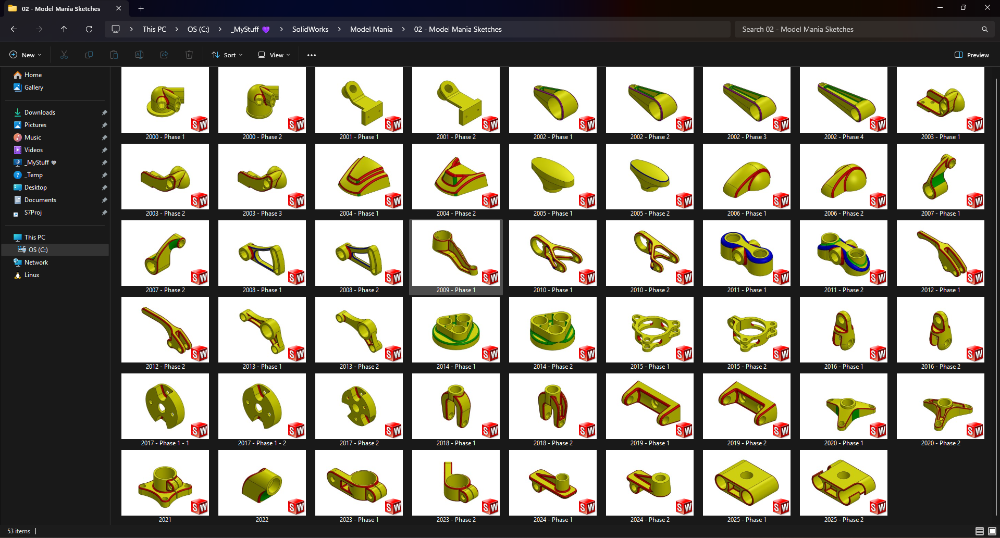
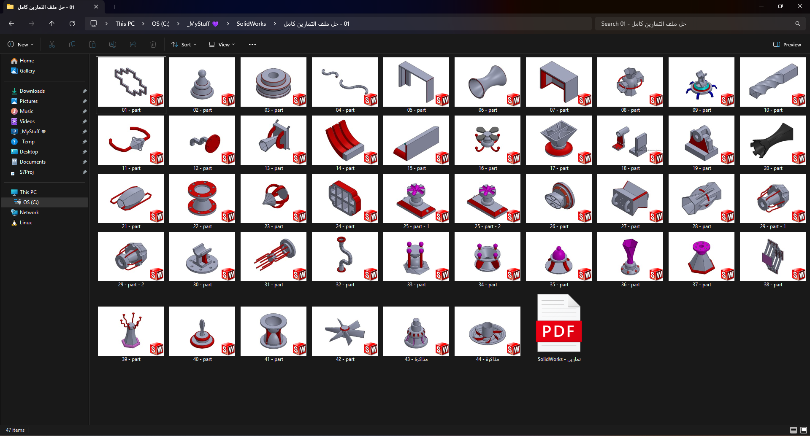

# SolidWorks Sketches: Model Mania & University Exercises

This repository contains my **SolidWorks** sketches and solutions for Model Mania challenges and university drawing exercises.

## Preview

### 1. Model Mania Solutions

### 2. University Exercises Solutions

## Files Included
* **`Model_Mania_Sketches.zip`**: Compressed archive containing the SolidWorks sketches I drew for Model Mania.
* **`University_Exercises_Sketches.zip`**: Compressed archive containing the SolidWorks sketches for the university exercises.

## Telegram Archive
* All prepared Model Mania sketches for **Phase 1 & Phase 2 (2000 - 2025)** are organized in this [Telegram Channel](https://t.me/Mecha_Hub/3411/3698).

---

## Contributors
* **Sherif Ainya** – [GitHub](https://github.com/Sherif-Ainya)
* **Mohammed Ghlion** - [Github](https://github.com/MohammedGhlion)
* 

---
